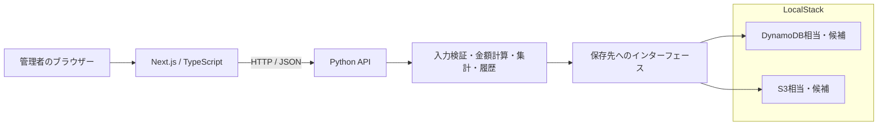
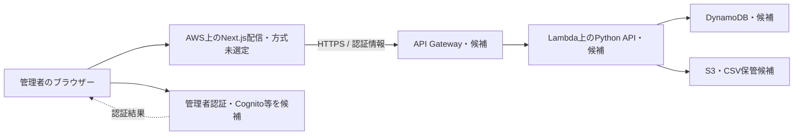

# Day 1：全体構成と設計判断

作成日・公式資料確認日：2026-10-28（Asia/Tokyo）。[要件](REQUIREMENTS.md) を満たすためのレビュー用設計案。

## 1. 今回決める境界

Next.js / TypeScriptが画面を、Python APIが業務ルールを担当する。LocalStackはローカル検証用のAWS API接続先として使い、実AWSとは環境を分離する。今日は構成と責務を整理し、アプリの起動・AWSへのデプロイは行わない。

| 項目 | Day 1での位置づけ | 確定・検証するDay |
| --- | --- | --- |
| Next.js / TypeScript、Python、LocalStack、AWS | ユーザー指定の技術 | 各Dayで構築・検証 |
| UIと業務APIの分離、金額計算の正本をAPIに置く | Day 1の設計案 | Day 1レビュー |
| PythonのAPIフレームワーク | FastAPIを候補とする。依存バージョンは未選定 | Day 2・5 |
| 売上・商品・履歴の永続化 | DynamoDBを第一候補とする。アクセスパターンを先に検証する | Day 4・6 |
| CSVの一時保管 | S3を候補とする | Day 17 |
| APIのAWS配置 | API Gateway + Lambdaを候補とする。Python APIの実行方法も検証する | Day 22・23 |
| 管理者認証 | Cognito等を候補とする。認証のローカル検証方法を分けて決める | Day 19 |
| Next.jsのAWS配信、IaC | レンダリング要件と費用を比較して選ぶ。Terraformは候補 | Day 11・22 |
| LocalStackのイメージ・利用プラン・対応API | Day 3で採用する版と必要条件を確認する | Day 3・6・17・19 |

候補を図に描くことは、そのサービスの採用・動作確認・契約の完了を意味しない。

## 2. ローカル開発の構成案

AWS接続はAPI側に集約し、ブラウザーからデータベースを直接操作しない。CSV取得はAPIが権限を確認して配信するか、短時間のダウンロードURLを返す案とする。方式はDay 17で確定する。

Next.jsのフォーム・期間選択などはクライアント側の対話処理が必要になる。一方、App Routerのページとレイアウトは既定ではServer Componentsであるため、`use client` の境界とPython APIの呼び出し場所をDay 11で定義する。ブラウザーとNext.jsサーバーでLocalStackへの接続処理を重複させない。[Next.js公式資料](https://nextjs.org/docs/app/getting-started/server-and-client-components)

## 3. AWS実環境の構成候補

認証・権限検証は画面の表示制御だけに依存しない。APIの入口と業務処理で、認証された管理者の操作であることを確認する。管理者用の自己登録や一般利用者のデータ閲覧は初期版に設けない。

Next.jsのサーバー機能が必要か、静的配信で足りるかは画面設計後に選ぶ。単にS3へ配置すれば任意のNext.jsアプリが動くとは仮定しない。API Gateway / Lambdaの制限、認証方式、AWSリージョン、費用、後片付け、IaCの実行差分はDay 22・23の確認事項とする。

## 4. コンポーネントの責務

| コンポーネント | 担当すること | 持たせない責務 |
| --- | --- | --- |
| Next.js UI | 入力補助、金額のプレビュー、一覧・グラフ・変更履歴、エラー表示 | 最終的な売上金額の決定、AWSの長期資格情報 |
| APIの入口 | 入力形式、認証・権限、日付と数値の正規化、エラー応答 | 商品価格を画面の値だけで信用すること |
| 業務処理 | `BR-01`〜`BR-06`、合計計算、状態遷移、集計条件、CSV用データの選別 | AWS SDK固有のデータ形式 |
| 保存先の実装 | 読み書き、ページング、条件付き更新、原子的な保存、環境ごとの接続先 | 二重の金額計算ルール |
| 認証コンポーネント | 管理者の本人確認、検証可能な操作者IDの提供 | ブラウザー申告の操作者IDをそのまま採用すること |

商品名や単価のスナップショットと最新版番号を保持し、商品マスタの更新や売上訂正を過去の金額へ無条件で波及させない。集計とCSV出力は、同じ期間・商品フィルター・有効状態の選別処理を共有する。

## 5. 保存・整合性の判断

### 商品と売上の保存

Day 4では、商品コードの重複確認、商品一覧、売上IDでの取得、期間一覧、商品別絞り込み、変更履歴の取得をアクセスパターンとして設計する。Day 1ではDynamoDBのテーブル数、キー、索引、エンドポイントを確定しない。

DynamoDBのトランザクションは複数項目の変更をまとめて成功・失敗させる機能を持つため、売上・明細・履歴・重複防止情報の整合性を保つ候補になる。採用時は条件式・項目数・項目サイズなどの制限をDay 4で確認する。[AWS公式資料](https://docs.aws.amazon.com/amazondynamodb/latest/developerguide/transactions.html)

### 登録・訂正・取消の流れ

1. 認証された操作者、入力、計上日、商品、数量・単価を検証する。
2. APIが明細金額と売上合計を計算する。訂正・取消では期待する版番号も確認する。
3. 必要な本体・明細・履歴・重複防止情報を、部分保存を残さない単位で更新する。
4. 保存できた最新の売上ID・版・金額を返す。画面はサーバーの結果を表示する。
5. 同時更新がない状態で再取得した集計とCSVが、保存した最新版に一致することを検証する。

### 集計の読み取り

DynamoDBのGSIは結果整合性で更新が伝播する。登録直後の集計が必ず最新になる前提でGSIだけを使う設計は採らない。[AWS公式資料](https://docs.aws.amazon.com/amazondynamodb/latest/developerguide/GSI.html#GSI.DataSynchronization)

Day 4で、期間の主キーQuery、必要な強い整合性の読み取り、日付訂正時の移動、ページング、全明細の取得を検証する。要件を満たせない場合は、保存方式やデータベース候補を見直す。日別・月別の事前集計値を別保存して使うかはDay 15で必要性を評価し、まず明細を正本として考える。

「同じデータ時点で集計とCSVが一致する」ことと、「複数要求の間に訂正があっても過去の画面とCSVが一致する」ことは分ける。初期版では後者の時点再現を提供しない。変更後は最新データで画面とCSVを再取得する。

## 6. LocalStackと実AWSの分離

LocalStackの公式資料にはDynamoDBとS3のローカルAPI利用が案内されている。ただし、採用バージョン・利用プランごとの必要APIと実AWSとの差は、実装するDayで確認する。[DynamoDBの公式案内](https://docs.localstack.cloud/aws/services/dynamodb/)、[S3の公式案内](https://docs.localstack.cloud/aws/services/s3/)

| 環境 | 接続と検証の方針 |
| --- | --- |
| ローカル・結合テスト | LocalStack用の接続先とダミーのAWS資格情報を明示。必要な接続先がなければ起動・接続を拒否し、実AWSに自動でフォールバックしない |
| AWS実環境 | LocalStackの接続先・ダミー資格情報を拒否。API実行環境のIAM権限を使い、ブラウザーへ秘密情報を渡さない |
| ローカル認証テスト | 認証方式の代替・テストダブルは明示したテスト環境だけで使う。実AWSへ持ち込めない構成にする |

Dockerのホストとコンテナでは到達可能なホスト名が異なるため、単一の `localhost` を全実行環境に使い回す前提にしない。PythonのSDKへの接続設定例は [LocalStack公式のBoto3案内](https://docs.localstack.cloud/aws/connecting/aws-sdks/python-boto3/) をDay 3・6で採用版に合わせて確認する。

LocalStackのAuth Token・利用条件はDay 3で確認する。必要なトークンはローカルの秘密情報として扱い、設定見本や記事に実値を載せない。[LocalStack公式のAuth Token案内](https://docs.localstack.cloud/aws/getting-started/auth-token/)

## 7. 設計判断と見直す条件

| ID | 判断 | 理由・見直す条件 |
| --- | --- | --- |
| ADR-01 | UIとPython業務APIを分ける | API経由で一つの金額・集計ルールを使う。Next.js側に別の売上確定処理を作らない |
| ADR-02 | 確認済みの税込整数円・整数数量を使い、取引時情報を保存する | 端数とマスタ変更による履歴の変動を避ける。小数数量や税額内訳が必要になれば再設計 |
| ADR-03 | 最新版を集計し、訂正・取消の履歴を残す | 売上の二重計上と理由不明の削除を避ける。月次ロック・時点帳票が必要なら別要件を追加 |
| ADR-04 | DynamoDBを第一候補にして先に検索を検証する | LocalStackとAWSで保存処理を学べる。期間検索・整合性・運用が要件を満たさなければ選択を変更 |
| ADR-05 | 認証なしのローカル作業を公開環境へ出さない | 認証の実装はDay 19でも、公開前には必須とする。先行するローカルAPIは架空データと明示したローカル環境だけで検証する |

## 8. Day 1の成果物と後続作業

| Day 1の成果物 | 後続Dayで行うこと |
| --- | --- |
| [REQUIREMENTS.md](REQUIREMENTS.md)：業務ルール・画面・受け入れ条件 | Day 2の開発環境、Day 4のデータ/API契約、Day 7以降の業務実装 |
| この構成図・責務・設計判断 | Day 3のLocalStack、Day 6の保存処理、Day 19の認証、Day 22・23のAWS構成 |
| [DAY1_REVIEW.md](DAY1_REVIEW.md)：要件の対応と架空例の確認 | 該当Dayで受け入れテストを実装し、実環境の動作を確認 |
| [Day 1記事](../qiita/day01-requirements-and-architecture.md) | レビュー承認後にmainへマージし、2026-12-01の公開を別途管理 |
