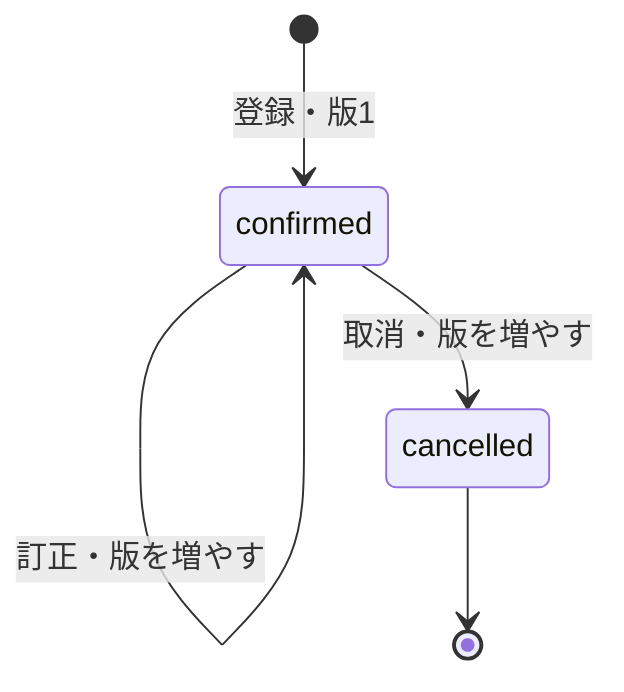

# Day 1：売上管理システムの要件

作成日・レビュー承認日：2026-10-28（Asia/Tokyo）。Day 1の承認済み設計。アプリケーションは未実装。

業務要件の正本をこのファイルとし、構成・設計判断は [ARCHITECTURE.md](ARCHITECTURE.md)、設計確認の結果は [DAY1_REVIEW.md](DAY1_REVIEW.md) に記録する。

## 1. 目的と確認状況

小規模店舗の管理者が、商品登録から売上登録、過去の売上参照、日別・月別・商品別集計、CSV出力まで行えることを完成の基準とする。

| 区分 | 内容 |
| --- | --- |
| ユーザー確認済み | 小規模店舗の商品別売上管理。利用者は管理者のみ。将来アカウントを分けても画面は共通 |
| ユーザー確認済み | 日本円の税込金額。日別・月別の表示切り替え、過去の売上参照、CSV出力 |
| Day 1でユーザー確認済み | 税込単価は整数円・数量は整数。小数入力を拒否し、税抜額・消費税額の内訳計算は初期範囲に含めない |
| Day 1でユーザー確認済み | 日本時間の取引日を手入力でき、過去日の登録・訂正・取消と変更履歴を認める。訂正後の最新版を集計し、取消済みは除外する |
| Day 1の提案・レビュー対象 | 商品・売上の入力項目、入力上限、期間指定、監査履歴、競合・重複送信への対応 |

当初の2点の回答による業務方針の合意に加え、2026-10-28に「Day 1レビューOK。」として、この設計と記事全体のレビュー承認を受けた。以後の要件変更は、影響する実装・設計・記事とともに管理する。

## 2. 利用者と対象範囲

初期版は単一店舗・単一の管理者権限を対象とする。複数アカウントを導入しても店舗のデータと画面は共通とし、操作した本人は履歴で区別する。

| 区分 | 対象 |
| --- | --- |
| 必須の業務フロー | 商品管理、売上登録・検索・詳細・訂正・取消、日別・月別・商品別集計、CSV出力 |
| 公開運用までに必要 | 認証・APIの権限検証、入力検証、監査履歴、テスト、監視、復旧手順 |
| 計画上の追加機能 | Day 18のCSV取り込み。CSV出力までの基本フローの完成と分けて評価する |
| 初期版の対象外 | 複数店舗・顧客台帳・在庫・決済・返金・一部返品・値引き計算・会計仕訳・請求書・税務申告・多通貨・複数ロール |

税込金額を記録する売上管理であり、税抜金額や消費税額を算出する帳票は初期版に含めない。

## 3. ユースケースと受け入れ条件

以下は後続Dayで実装・テストする条件。Day 1では、実装済みという意味ではなく、確認可能な完成条件を用意する。

| ID | ユースケース | 受け入れ条件 | 実装予定 |
| --- | --- | --- | --- |
| FR-01 | 商品を登録・変更する | 商品コード・名称・税込標準単価を登録できる。コードの重複と不正単価を拒否する。コードは登録後変更しない | Day 7・12 |
| FR-02 | 商品を無効化する | 物理削除せず無効化し、新しい売上で選べなくする。過去の売上は参照・訂正・取消できる | Day 7・12 |
| FR-03 | 売上を登録する | 計上日と1件以上の明細を登録する。APIが明細金額・合計を計算し、一部だけ保存しない | Day 8・13 |
| FR-04 | 売上を検索・参照する | 期間・商品・取消状態で絞り込み、一覧をページングできる。過去の取引日も検索できる | Day 9・14 |
| FR-05 | 売上を訂正する | 売上IDを維持し、最新版だけを集計する。変更前後・操作者・日時・理由を残す | Day 10・14 |
| FR-06 | 売上を取り消す | 理由付きで取消済みにでき、売上と履歴を保持する。取消済みは集計から除外し、再訂正・復活は拒否する | Day 10・14 |
| FR-07 | 日別・月別に集計する | 期間と集計単位を独立して指定できる。同一データ時点の有効売上の明細合計と総売上が一致し、売上IDで重複しない件数・販売数量を表示する | Day 15・16 |
| FR-08 | 商品別に集計する | 商品IDごとに数量・税込売上を合計する。同じ名称の商品を混同せず、改名・価格変更で過去金額が変わらない | Day 15・16 |
| FR-09 | CSVを出力する | 検索条件と同じ期間・商品で有効明細を出力する。CSVの金額合計と画面集計が一致する | Day 17 |
| FR-10 | 管理者として操作する | 未認証・権限なしのAPI要求を拒否する。公開環境で認証を回避できない | Day 19 |
| FR-11 | 重複・競合を防ぐ | 同じ登録要求の再送で売上を増やさず、古い版での訂正・取消を競合として拒否する | Day 8・10 |

## 4. 画面と最小限のデータ

| 画面 | 主な操作・表示 | 対応要件 |
| --- | --- | --- |
| 商品管理 | 一覧、登録、名称・標準単価の変更、無効化 | FR-01・FR-02 |
| 売上登録 | 計上日、商品、実際の税込単価、数量、金額の確認 | FR-03・FR-11 |
| 売上一覧・詳細 | 期間・商品・状態検索、ページ切り替え、明細、変更履歴、訂正・取消 | FR-04・FR-05・FR-06・FR-11 |
| ダッシュボード | 今日・今月・前月などの期間選択、任意期間、日別・月別、商品別、CSV出力 | FR-07・FR-08・FR-09 |
| ログイン | 管理者の認証。認証後は全管理者が同じ画面を使う | FR-10 |

表示名は設計上の名称であり、URL・コンポーネント・API仕様はDay 4・11以降に具体化する。

| 概念 | 保持する情報の案 |
| --- | --- |
| 商品 | 変更しない商品ID・商品コード、名称、税込標準単価、有効状態、作成・更新日時 |
| 売上 | 変更しない売上ID、計上日、`confirmed` / `cancelled`、最新版番号、税込合計、作成・更新日時 |
| 売上明細 | 明細番号、商品ID、取引時の商品コード・名称・税込単価、数量、明細金額 |
| 変更履歴 | 売上ID、版番号、作成・訂正・取消の種別、変更前後、操作者ID、操作日時、訂正・取消の理由 |
| 重複防止情報 | 操作者と登録要求ID、入力内容の識別情報、登録された売上ID |

売上明細には商品情報をスナップショットとして保存する。標準単価を初期表示し、過去日の登録にも対応できるよう実際の税込単価を入力できる。商品マスタの更新は、登録済み売上の単価・名称を自動で書き換えない。

商品検索で該当する売上が見つかっても、商品別集計・CSVでは条件に一致する明細だけを対象にする。売上詳細では全明細を表示し、「売上全体の合計」と「検索対象商品の金額」を区別する。

## 5. 売上の基本ルール案

### BR-01：金額・数量・端数

- 通貨は日本円。税込単価は1円単位の整数、数量は正の整数とする。文字列の暗黙変換や小数の丸め込みを行わず、不正入力として返す。
- 明細金額 = 取引時の税込単価 × 数量。売上合計 = 明細金額の合計。税額の加算・逆算は行わないため、この範囲では端数処理は発生しない。
- APIを計算結果の正本とする。画面の合計は確認表示であり、クライアントから渡された合計値を保存値として信用しない。金額計算に二進浮動小数点を使わない。
- 入力上限の提案は、税込単価0〜9,999,999円、数量1〜9,999、1売上1〜50明細、売上合計9,999,999,999円以下。上限超過は拒否する。無料の明細は0円で表現できるが、負の金額・数量で返品を表現しない。
- 小数数量・税額内訳が必要になった場合は、丸めの対象・方式・タイミングを別途決め、データと受け入れ条件を見直す。

### BR-02：計上日・過去の売上

- `sale_date` は取引した営業上の日付を `YYYY-MM-DD` で保持する。初期表示はAPIの時計で求めた日本時間の本日。登録日とは分けて扱う。
- 店舗のタイムゾーンは `Asia/Tokyo`。日付の境界は0:00。過去日の登録・訂正・取消を認め、売上の登録・訂正に未来の計上日を指定する操作は拒否する案とする。締め日・月次ロックは初期版に設けない案とする。
- 作成・更新・操作の時刻はタイムゾーン付きUTCで保持し、画面では日本時間で表示する。
- 過去の売上参照は「過去の計上日を、現在の訂正・取消を反映した状態で見る」ことを意味する。当時出力した帳票や締め時点の状態を再現する機能は初期版の対象外。

### BR-03：訂正・取消・履歴

訂正済みを独立した売上状態にはせず、`confirmed` の最新版を更新する。訂正前の版は履歴に残し、二重に集計しない。計上日を変更した場合は、元の日付から新しい日付へ集計対象が移る。

訂正・取消には理由を必須とし、売上IDと履歴を残す。取消済み売上の金額を0円に書き換える必要はなく、集計対象から除外する。取消を取り消す操作や物理削除は設けず、必要なら新しい売上を登録する。

無効商品を含む既存売上の訂正・取消は可能とする。訂正で別商品に差し替える場合は有効商品のみ選べる。保持する明細の取引時単価・商品名は、明示的に変更しない限り維持する。

### BR-04：期間・集計単位・商品フィルター

- 画面の開始日・終了日は両端を含む。内部では開始日以上・終了日の翌日未満の半開区間へ正規化する。
- 検索期間には未来の日付を含めてよい。今月末までを選択しても、将来の計上日で売上を登録できることは意味しない。
- 集計単位は `day` / `month`。期間の選択とは別に指定する。月の途中を含む期間も、指定期間に含まれる分だけ集計し、対象期間を画面とCSVに明示する。
- 1回の検索・集計・CSV出力は最大366日を提案する。より古いデータも期間を変えて参照でき、保持データを自動削除しない。
- 集計は常に `confirmed` の最新版のみ。取消の表示切り替えは一覧検索用とし、売上の集計対象は変えない。
- 商品フィルターを指定した場合、当該商品の明細だけで数量・金額を計算する。期間内にデータがなければ合計は0円。日別・月別グラフの空の区間も0として表示する。
- 主な指標は税込総売上・売上件数・販売数量とする。売上件数は対象明細を持つ売上IDの重複なしの件数であり、CSVの明細行数とは異なる。平均単価など追加の丸めが必要な指標は初期の完成条件に含めない。
- 同時更新がない状態で、登録・訂正・取消の完了後に再取得した明細・集計・CSVを一致させる。集計とCSVは同じ選別・計算処理を使う。

### BR-05：CSV出力

1行を1売上明細とし、売上ID、計上日、商品ID、取引時の商品名、税込単価、数量、明細金額、版番号を含める案とする。売上全体の合計を全明細行へ繰り返して合算しない。

標準の売上CSVは有効売上のみを対象とする。同じ条件・同じデータ時点なら、CSVの明細金額合計と画面の総売上が一致する。出力日時と検索条件を関連付け、出力後に訂正があれば再出力した値は変わり得ることを示す。列名・文字コード・引用・数式として解釈される値の扱いはDay 17で確定・検証する。

### BR-06：重複送信・同時更新

登録要求には重複防止IDを付ける。同じ操作者・同じID・同じ内容の再送は最初の結果を返し、同じIDで内容が異なれば競合として拒否する。訂正・取消は期待する版番号と一致した場合だけ実行する。

売上本体・明細・変更履歴・重複防止情報の整合性を保ち、失敗時に一部だけ成功した状態を残さない。保存方法と保持期限、HTTP応答形式はDay 4・8・10で具体化する。

## 6. 運用・品質の要件

| ID | 方針と確認方法 | 主な確認Day |
| --- | --- | --- |
| NFR-01 | 業務ロジックをPython側にまとめ、画面を通さない要求でも同じ入力検証・認証・権限検証を適用する | Day 5〜10・19 |
| NFR-02 | ローカルの保存先をLocalStackに固定し、実AWSへ意図せず接続しない。AWS実環境の権限・設定・データを分離する | Day 3・6・22・23 |
| NFR-03 | 認証情報・実店舗のデータをGitや記事に含めず、アプリケーションログに認証トークンを出さない | 各Day・21・24 |
| NFR-04 | 全件走査を前提にせず、期間検索の取得漏れ・ページング・登録直後の整合性を検証する | Day 4・9・15・20 |
| NFR-05 | 保存データと履歴のバックアップ・復旧を確認し、誤操作や障害の調査に売上IDと操作者を使えるようにする | Day 10・24 |
| NFR-06 | 起動・停止、依存バージョン、設定見本、テスト、AWS資源の後片付けを再現可能にする | Day 2・3・21〜25 |

規模の設計仮定は「1店舗、商品1,000件、1日100売上、通常1売上10明細以内」。保証済みの性能値ではなく、Day 20で測定条件を定めて検証するための仮定である。

## 7. 完成までの確認シナリオ

1. 管理者が商品を登録する。
2. 同じ商品を複数明細・複数日にわたって売上登録する。
3. 商品マスタの単価・名称を変更し、過去の売上が保持されていることを確認する。
4. 過去の売上を検索して訂正し、別の売上を取り消す。履歴を確認する。
5. 日別・月別・商品別に集計し、期間外と取消済みが含まれないことを確認する。
6. 同じ条件のCSVを出力し、明細金額の合計を照合する。
7. 未認証・不正入力・重複送信・競合を試し、意図しない更新がないことを確認する。

Day 1の設計例と確認結果は [DAY1_REVIEW.md](DAY1_REVIEW.md) に記載する。実装の受け入れテストは該当するDayに行う。
