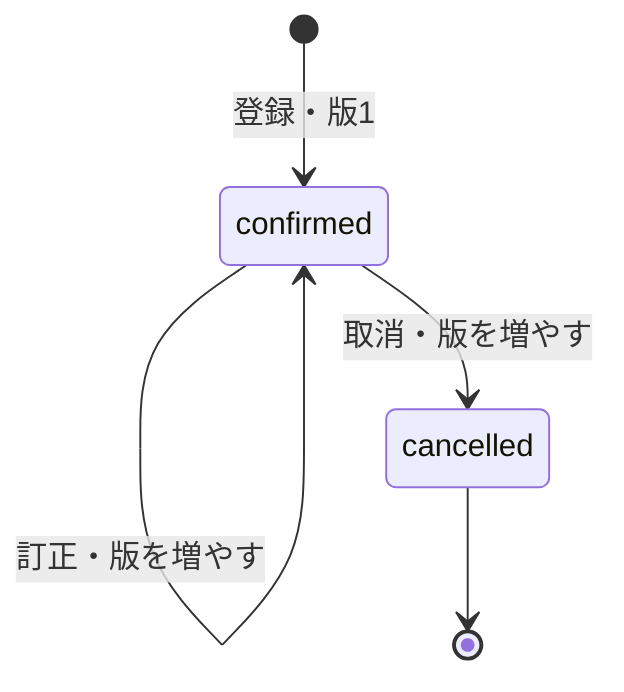
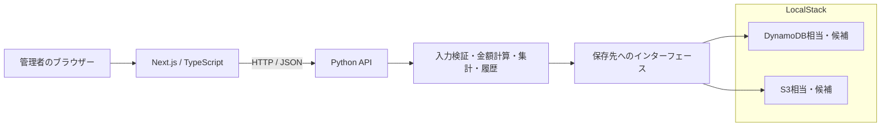

# 【Day 01】25日で売上管理システムを作る：要件定義と全体設計

シリーズ：**Next.js・Python・LocalStack・AWSで作る売上管理システム**

前回：[Day 0：プロジェクトとGitHubの準備](day00-project-setup-and-github.md)

公開予定：2026年12月1日（日本時間）。開発・レビューとQiitaへの公開は別に管理しています。

## はじめに

小規模店舗の商品別売上を管理するシステムを、25回に分けて作ります。商品を登録し、売上を入力し、過去の期間を日別・月別・商品別に集計してCSVへ出力するところまでを、一連の流れとして完成させる予定です。

Day 1では、画面やAPIを実装する前に「何ができれば完成なのか」と「同じ売上をどう計算するのか」を整理しました。成果物は要件定義、全体構成図、設計例の確認記録です。Next.js・Pythonの環境構築や、LocalStack・AWSでの動作確認はまだ行っていません。

## この記事の到達点

- 利用者と対象範囲、機能ごとの完成条件を説明できる
- 税込金額、計上日、訂正・取消、日別・月別の集計ルールをそろえる
- Next.js、Python API、LocalStack、AWSの役割を分ける
- 架空の売上を使い、集計とCSVの期待値を確認する

リポジトリは [sales-manager-dashboard](https://github.com/hirolisberger/sales-manager-dashboard) です。設計の詳細は [要件定義](../docs/REQUIREMENTS.md)、[全体設計](../docs/ARCHITECTURE.md)、[設計確認記録](../docs/DAY1_REVIEW.md) に分けています。

本記事の公式資料は2026年10月28日に確認しました。ツールの採用バージョンは、構築するDayで確認して固定します。

## 1. 使う人と完成の基準を決める

利用者は店舗の管理者だけです。将来アカウントを分けても、同じ店舗のデータと画面を使う想定です。誰が操作したかは履歴に残します。

| 対象 | 完成したと判断する条件 |
| --- | --- |
| 商品管理 | 商品コード・名称・税込標準単価を登録できる。使わない商品は無効化できる |
| 売上登録 | 計上日、商品、実際の税込単価、数量を登録し、APIが金額を確定できる |
| 売上参照 | 過去の期間や商品で検索し、明細・訂正履歴を参照できる |
| 訂正・取消 | 元の記録と理由を残し、集計へ反映できる |
| 集計 | 指定期間を日別・月別・商品別に集計できる |
| CSV出力 | 画面と同じ条件で明細を出力し、合計が一致する |

複数店舗、在庫、決済、顧客台帳、返金・一部返品、会計仕訳などは初期版の対象外にします。CSV取り込みはDay 18の追加機能として残しますが、まずは商品登録からCSV出力までをつなげます。

## 2. 税込整数円と整数数量を使う

金額については、次の方針を確認しました。

- 税込単価は1円単位の整数
- 数量は正の整数
- 小数の単価・数量は丸めず、入力エラーにする
- 税抜金額や消費税額の内訳計算は初期範囲に含めない

計算式は次の二つです。

```text
明細金額 = 取引時の税込単価 × 数量
売上合計 = 明細金額の合計
```

この範囲では、金額計算に端数が発生しません。550.5円や数量1.5を受け入れて後から丸める処理も設けません。小数数量や税額内訳が必要になったときは、どの単位で何を丸めるかを別の要件として決めます。

画面で合計を表示しても、保存する金額はPython APIが再計算します。クライアントが送った合計値をそのまま信用しない方針です。Python側も二進浮動小数点で金額を計算せず、今回の範囲は整数で扱います。

単価0円の許可、単価・数量・明細数・合計額の上限はレビュー対象の設計案として、要件定義に具体的な値を記載しました。

## 3. 商品の今の値と、売上の取引時の値を分ける

商品マスタの価格を変更しただけで、過去の売上が変わると困ります。売上明細には商品IDに加えて、取引時の商品コード・名称・税込単価を保存します。

たとえば、550円で販売したコーヒーの商品マスタを翌日に600円へ変更しても、昨日の明細は550円のままです。過去日の売上を後から入力する場合もあるため、標準単価を入力の初期値とし、実際に取引した税込単価を記録できるようにします。

商品を無効化しても、過去の明細は残します。新しい売上で無効商品を選ぶ操作と、無効商品を含む既存売上の訂正・取消は分けて考えます。

## 4. 登録した日と、売上を計上する日を分ける

計上日は日本時間の取引日を手入力でき、過去日の登録・訂正・取消を認める方針です。操作した時刻とは別の情報として保持します。

| 情報 | 保持する値の例 | 用途 |
| --- | --- | --- |
| 計上日 `sale_date` | `2026-12-01` | 日別・月別の売上集計 |
| 作成・更新・操作の時刻 | タイムゾーン付きUTC | いつ登録・訂正したかの調査 |
| 店舗のタイムゾーン | `Asia/Tokyo` | 本日と日付境界の判定・表示 |

締め日や月次ロックは初期版に設けない案です。過去の売上を見るときは、現在の訂正・取消を反映した値を表示します。過去に出力した帳票の状態をそのまま再現する機能は、別の要件になります。

## 5. 訂正は最新版を更新し、取消は集計から外す

売上の状態は `confirmed` と `cancelled` の二つにします。訂正済みを新しい集計対象の売上として増やさず、同じ売上IDの版番号を増やします。



訂正・取消の理由、操作者、日時、変更前後を履歴に残します。日別・月別集計には、`confirmed` の最新版だけを含めます。取消前の金額や訂正前の版を、もう一度加算しないことが重要です。

取消済みの売上を削除する必要はありません。金額を保持したまま対象から外せます。取消の復活を設けないことや、古い版での同時更新を拒否することも、設計案に含めました。

## 6. 期間と、日別・月別の集計単位を分ける

「どの期間を見るか」と「どの単位で並べるか」を別々に指定します。

たとえば、期間を2026年12月1日〜31日にして日別を選べば、12月1日、2日……の金額を表示します。同じ期間で月別を選べば12月分の合計を表示します。過去の期間も同じ操作で参照できます。

画面の終了日は含め、内部では翌日を含まない形へそろえる案です。

```text
画面：2026-12-01 〜 2026-12-31
内部：2026-12-01 <= sale_date < 2027-01-01
```

商品フィルターも明細単位で適用します。コーヒーと紅茶を一緒に売った売上から紅茶だけを集計する場合、売上全体の合計を紅茶の金額として使いません。

CSVも同じ期間・商品・有効状態で明細を選びます。同時更新がない同じデータ時点なら、CSVの明細金額合計と画面の総売上が一致することを受け入れ条件にしました。

## 7. 画面と業務ルールの責務を分ける

ローカル開発の構成案は次のとおりです。



Next.jsはフォームや期間選択、一覧、グラフを担当し、Python APIに業務ルールをまとめます。App Routerではページ・レイアウトが既定でServer Componentsになるため、フォームなどのクライアント側の境界は画面を作るDayで定義します。[Next.js公式資料](https://nextjs.org/docs/app/getting-started/server-and-client-components)

LocalStackではDynamoDBとS3のAPIをローカルで使う案です。対応APIや利用条件、採用バージョンはDay 3以降で確認し、実AWSと同じ挙動を検証できたとはまだ扱いません。[DynamoDBの公式案内](https://docs.localstack.cloud/aws/services/dynamodb/)、[S3の公式案内](https://docs.localstack.cloud/aws/services/s3/)

AWS実環境ではAPI Gateway + Lambda、DynamoDB、S3、認証のCognitoなどを候補にしています。Next.jsの配信方式を含め、採否は該当Dayの検証を経て決定します。

### 保存方法で先に確認したいこと

売上本体だけ保存され、明細や履歴が保存されない状態は避ける必要があります。DynamoDBのトランザクションは複数項目をまとめて成功・失敗させる機能を持つため、保存方法の候補として調べました。[AWS公式資料](https://docs.aws.amazon.com/amazondynamodb/latest/developerguide/transactions.html)

また、GSIは更新が非同期で反映されるため、「登録直後の集計も必ず最新」という条件をGSIだけで満たす前提にはしません。期間検索のキーと読み取り方式はDay 4で検証します。[AWS公式資料](https://docs.aws.amazon.com/amazondynamodb/latest/developerguide/GSI.html#GSI.DataSynchronization)

## 8. 架空の売上で、完成条件を確かめる

以下は**本日を2027年1月5日と仮定した設計上の例**です。動作するアプリへ登録した結果ではありません。

| 売上 | 計上日 | 最初の明細 | 金額 |
| --- | --- | --- | --- |
| S001 | 2026-12-01 | コーヒー550円×2、紅茶330円×1 | 1,430円 |
| S002 | 2026-12-01 | 紅茶330円×2 | 660円 |
| S003 | 2026-12-02 | コーヒー550円×1 | 550円 |

最初の12月分は2,640円です。S001をコーヒー1・紅茶1の880円へ訂正すると2,090円になり、S002を取り消すと1,430円になります。

| 確認する表示 | 訂正・取消後の期待値 |
| --- | --- |
| 日別 | 12月1日880円、12月2日550円 |
| 月別 | 12月1,430円 |
| 商品別 | コーヒー2個・1,100円、紅茶1個・330円 |
| 紅茶だけの検索・集計 | 330円 |
| CSV | 有効な3明細・合計1,430円 |

さらに期間外の11月30日と翌年1月1日の売上を加え、12月分に混ざらないこと、計上日を別月へ訂正すると集計先も移ることを確認する例を用意しました。

## 今回の確認結果

設計例の金額、商品フィルター、日付移動、CSVの行数、JSTと月境界の期待値をPython標準ライブラリで照合しました。基本の金額と日付境界は、Python 3.9以上でIANAタイムゾーンデータが利用できる環境なら次のように確認できます。今回はmacOSで確認しました。この確認用Pythonと、Day 2で選ぶアプリケーションの採用バージョンは分けて扱います。[Python公式のzoneinfo資料](https://docs.python.org/3/library/zoneinfo.html)

```sh
python3 - <<'PY'
from datetime import datetime
from zoneinfo import ZoneInfo

before = (550 * 2 + 330) + 330 * 2 + 550
corrected = (550 + 330) + 330 * 2 + 550
cancelled = (550 + 330) + 550
print(before, corrected, cancelled)
boundary = datetime.fromisoformat("2026-11-30T15:00:00+00:00")
print(boundary.astimezone(ZoneInfo("Asia/Tokyo")).isoformat())
PY
```

確認結果は次のとおりです。

```text
2640 2090 1430
2026-12-01T00:00:00+09:00
```

要件と画面・データ・実装予定Dayの対応、ローカル文書リンク、Markdownの表・書式、記事の匿名化も確認対象にしています。実行結果の詳細は [設計確認記録](../docs/DAY1_REVIEW.md) に残します。

これは設計の整合性確認です。API・画面の動作、DynamoDBへの原子的な保存、認証、LocalStackと実AWSの差は、実装するDayでテストします。Mermaidの図は構成と遷移を確認していますが、レンダラーでの表示確認は未実施です。

## まとめと次回

Day 1では、完成条件と売上の基本ルールを整理し、Next.jsとPython APIの責務を分けました。税込整数円、取引時の値の保存、最新版の集計を先に決めることで、画面とCSVが同じ金額になるかを確認しやすくなりました。

この設計と記事をレビューしてから、次のDay 2でNext.jsとPythonの開発環境を整えます。Day 1のレビュー承認前には次のDayへ進みません。記事の公開予定日は2026年12月1日で、開発・レビューとは分けて管理します。
